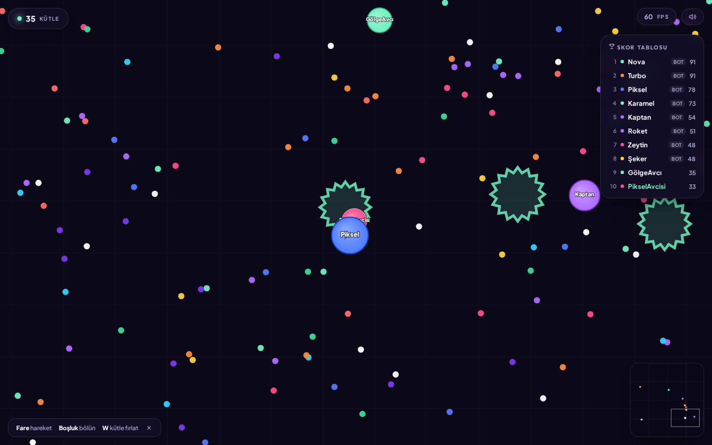

# 🎮 Hücre Arena

Tarayıcıda çalışan, **gerçek zamanlı çok oyunculu (PvP)** hücre yeme oyunu.
Agar.io'dan esinlenilmiş *mekanikler* kullanır; ancak tüm kod, arayüz ve grafikler
sıfırdan, özgün olarak yazılmıştır (marka, isim, logo veya hazır varlık kopyası yoktur).



---

## ✨ Özellikler

| Özellik | Açıklama |
|---|---|
| **Gerçek PvP** | WebSocket (Socket.IO) üzerinden aynı odada onlarca oyuncu |
| **Otoriter sunucu** | Tüm fizik ve çarpışmalar sunucuda hesaplanır → hile yapılamaz |
| **Büyüme mekaniği** | Yem topla, küçük hücreleri yut, kütlen arttıkça yavaşla |
| **Bölünme (Split)** | `Boşluk` ile ikiye ayrıl, kütleyi ileri fırlat |
| **Kütle fırlatma** | `W` ile kütle atıp dostunu besle ya da virüsü tetikle |
| **Dikenli virüsler** | Fazla büyürsen çarptığında parçalanırsın |
| **Bot doldurma** | Boş sunucuda yalnız kalmamak için akıllı botlar (yem arar, kaçar, avlanır) |
| **Yumuşak kamera** | Kütleye göre otomatik zoom, dünya sınırlarına kilitli kamera |
| **İnterpolasyon** | 20 Hz sunucu yayını, 60 FPS akıcı çizim |
| **Mini harita + skor tablosu** | Canlı sıralama ve konum takibi |
| **Mobil destek** | Dokunmatik kontrol + mobil BÖLÜN/FIRLAT düğmeleri |
| **Tek dosya istemci** | Derleme/paketleme adımı yok — düzenle, kaydet, yenile |

---

## 🚀 Çalıştırma (yerel)

Gereken: **Node.js 18+** ([nodejs.org](https://nodejs.org))

```bash
cd hucre-arena
npm install
npm start
```

Tarayıcıda aç: **http://localhost:3000**

Aynı Wi-Fi'deki telefondan test etmek için:
bilgisayarın yerel IP'sini (örn. `192.168.1.20`) kullan → `http://192.168.1.20:3000`

Geliştirirken otomatik yeniden başlatma için:

```bash
npm run dev
```

---

## 🎯 Kontroller

| Girdi | Etki |
|---|---|
| **Fare / dokunma** | Hücren imlece doğru gider |
| **Boşluk** | Bölün (min. 36 kütle) |
| **W (basılı tut)** | Kütle fırlat (min. 35 kütle) |

---

## ⚙️ Ayarlar

Sunucu tarafında `server.js` başında:

```js
const W = 3600;            // dünya boyutu
const H = 3600;
const FOOD_TARGET = 1500;  // haritadaki yem sayısı
const VIRUS_TARGET = 20;   // dikenli virüs sayısı
const START_MASS = 22;     // başlangıç kütlesi
const MERGE_TIME = 14;     // bölündükten sonra birleşme süresi (sn)
```

Ortam değişkenleri:

| Değişken | Varsayılan | Açıklama |
|---|---|---|
| `PORT` | `3000` | Sunucu portu |
| `BOTS` | `8` | Yapay zekâ bot sayısı (`BOTS=0` → bot yok) |

```bash
BOTS=0 PORT=8080 npm start
```

Tema renkleri: `public/style.css` içindeki `:root` değişkenleri.
Hücre renk paleti: `server.js` içindeki `COLORS` dizisi.

---

## ☁️ Ücretsiz yayınlama

> ⚠️ **Önemli:** Bu bir WebSocket sunucusudur. GitHub Pages / Netlify / Vercel gibi
> **statik** hosting'lerde çalışmaz, çünkü Node.js süreci gerekir.
> Aşağıdaki ücretsiz **Node hosting** servislerinden birini kullan.

### 1) Render.com (en kolay, ücretsiz katman)

1. [github.com](https://github.com) hesabı aç → yeni **private/public repo** oluştur.
2. Bu klasördeki dosyaları repoya yükle (`node_modules` hariç):
   ```bash
   git init
   git add .
   git commit -m "Hücre Arena"
   git branch -M main
   git remote add origin https://github.com/KULLANICI/REPO.git
   git push -u origin main
   ```
3. [render.com](https://render.com) → **New +** → **Web Service** → repoyu bağla.
4. Ayarlar:
   - **Environment:** `Node`
   - **Build Command:** `npm install`
   - **Start Command:** `npm start`
   - **Instance Type:** `Free`
5. **Create Web Service** → 2-3 dakika sonra `https://senin-siten.onrender.com` hazır.

> Ücretsiz katmanda servis 15 dk trafik almazsa uyur; ilk açılış ~30 sn sürebilir.
> Trafiğin artarsa Render'ın ücretli küçük planı yeterli olur.

### 2) Koyeb / Railway / Fly.io

Aynı mantık: repoyu bağla → `npm install` + `npm start`.
Hepsinin ücretsiz başlangıç katmanı WebSocket destekler.

### 3) Kendi VPS'in (en performanslı)

```bash
# sunucuda
git clone <repo> && cd hucre-arena
npm install --omit=dev

# pm2 ile 7/24 çalıştır
npm i -g pm2
pm2 start server.js --name hucre-arena
pm2 save && pm2 startup
```

Nginx reverse proxy (WebSocket için `Upgrade` başlıkları şart):

```nginx
location / {
    proxy_pass http://127.0.0.1:3000;
    proxy_http_version 1.1;
    proxy_set_header Upgrade $http_upgrade;
    proxy_set_header Connection "upgrade";
    proxy_set_header Host $host;
}
```

### Alan adı bağlama

Hosting panelinde **Custom Domain** → `oyun.alanadim.com` yaz →
DNS'te `CNAME` kaydı oluştur. Ücretsiz SSL (Let's Encrypt) otomatik gelir.

---

## 📁 Dosya yapısı

```
hucre-arena/
├── server.js            # Oyun sunucusu: fizik, çarpışma, botlar, ağ
├── package.json
├── public/
│   ├── index.html       # Menü, HUD, ölüm ekranı
│   ├── style.css        # Arayüz teması
│   └── game.js          # Canvas render + girdi yönetimi
└── README.md
```

---

## 🔧 Nasıl çalışıyor? (teknik özet)

- **Sunucu 60 Hz** fizik adımı çalıştırır, istemcilere **20 Hz** durum paketi yollar.
- Konum/girdi doğrulaması sunucuda → istemci sadece "hedef nokta" gönderir.
- Çarpışma kontrolü **uzamsal ızgara (spatial hash)** ile yapılır → O(n²) yerine
  yalnızca yakın komşular taranır, 100+ hücrede bile CPU düşük kalır.
- Yem haritaya bir kez gönderilir; sonrasında sadece `food:add` / `food:remove`
  olayları yayınlanır → bant genişliği düşük (~5-15 KB/sn).
- İstemci, sunucudan gelen konumları **üstel yumuşatma** ile interpolasyon eder →
  düşük paket hızında bile akıcı görüntü.
- Yarıçap–kütle ilişkisi `r = 4·√m`, hız `v = 250·m^-0.22 + 25` → büyüdükçe
  yavaşlama hissi (klasik hücre oyunu dengesi).

---

## 📜 Lisans / Yasal not

Kod **MIT** lisansı ile serbestçe kullanılabilir. Agar.io ve benzeri isimler ilgili
sahiplerinin ticari markalarıdır; bu proje onlarla bağlantılı değildir ve hiçbir
özgün varlığını (görsel, ses, kod, marka) içermez. Yayına alırken kendi adını,
logonu ve renklerini kullanman önerilir.
